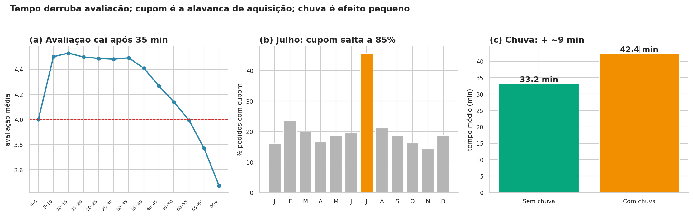

# Tempo de entrega derruba a avaliação a partir de 35 min e cupom é a alavanca de aquisição: diagnóstico de 2024 do app de delivery

> A avaliação dos clientes cai consistentemente após 35 min de entrega (−0,4 ponto entre entregas até 35 vs. acima de 35 min; ρ ≈ −0,22; p < 0,001). Em paralelo, o cupom é a única alavanca comprovada de aquisição: pedidos com cupom têm 65% de clientes novos vs. 20% sem cupom (+45 p.p.; p < 0,001) — e a campanha de julho dobrou o volume diário do app. A diretoria deveria (1) revisar o SLA de 45 min para 60 min (ou 45 apenas para pedidos curtos e sem chuva) e (2) replicar a campanha de julho de 2025 com cupom segmentado por cozinha.



*[Painel (a): avaliação média por faixa de tempo — queda a partir de ~35 min. Painel (b): % de pedidos com cupom por mês — julho salta a ~85%. Painel (c): tempo médio de entrega com vs. sem chuva — +3 min. Base: 8.058 pedidos, 2024.]*

---

## 1. Pergunta de negócio

A diretoria do app de delivery vai planejar 2025 e pediu um diagnóstico de 2024 antes da reunião de orçamento. A análise investiga **três frentes**: **operação** (quando os pedidos acontecem, quanto tempo demoram e o que atrasa), **clientes** (quanto gastam, como avaliam e o que derruba a nota) e **alavancas** (efeito real dos cupons — inclusive da campanha "Julho de cupons" — e da chuva).

**Perguntas que guiaram a análise:**

1. Em que horários e dias da semana os pedidos se concentram?
2. Qual o tempo típico de entrega e quantos pedidos quebram a promessa de 45 min?
3. Quanto o cliente gasta por pedido e como isso varia por tipo de cozinha?
4. O cupom aumenta o ticket ou só canibaliza margem? Ele traz clientes novos?
5. A chuva afeta o tempo de entrega e o volume de pedidos?

---

## 2. Dados

- **Fonte:** `delivery_pedidos.csv`, fornecida no módulo DS-PY-018 (dados simulados de um app de delivery).
- **Período e escopo:** 01/01/2024 a 31/12/2024; São Paulo, Rio de Janeiro e Belo Horizonte.
- **Tamanho:** 8.058 linhas × 18 colunas (original) → 8.058 linhas × 22 colunas (limpa, incluindo 3 flags e 4 colunas de data).
- **Unidade de observação:** um pedido.

### Dicionário da base limpa (`saidas/delivery_pedidos_limpo.csv`)

[Gere esta tabela pelo notebook (Tarefa 11.1) e complete a descrição. Inclua as colunas e as **flags** que vocês criaram.]

| Coluna | Tipo | Descrição | % faltantes | Observação / tratamento |
|---|---|---|---|---|
| `pedido_id` | int | identificador do pedido | 0 | sem tratamento |
| `data_hora` | datetime | data e hora do pedido | 0 | convertida de texto |
| `cidade` | texto | cidade de entrega | 0 | 13 variantes padronizadas para 3 nomes |
| `bairro` | texto | bairro de entrega | 0 | — |
| `restaurante_id` | texto | identificador do restaurante | 0 | — |
| `tipo_cozinha` | texto | categoria da cozinha | 0 | — |
| `plataforma` | texto | Android, iOS, Web | 0 | NaN preenchido com "Desconhecido" (~15 linhas) |
| `forma_pagamento` | texto | forma de pagamento | 0 | 8 variantes padronizadas para 4 nomes |
| `cupom` | bool | usou cupom | 0 | "Sim"/"Não" → True/False |
| `cliente_novo` | bool | primeiro pedido do cliente | 0 | "True"/"False" → bool |
| `chuva` | bool | choveu na cidade no dia | 0 | "True"/"False" → bool |
| `distancia_km` | float | distância restaurante → cliente | ~1,1% | > 100 km → NaN (8 linhas) + flag |
| `tempo_entrega_min` | float | minutos do pedido à entrega | ~0,4% | 999 e negativos → NaN (33 linhas) + flag |
| `valor_pedido` | float | valor dos itens em R$ | 0 | ~720 valores em formato "R$ 44,02" convertidos |
| `taxa_entrega` | float | taxa de entrega em R$ | 0 | — |
| `avaliacao` | float | nota de 1 a 5 | ~17% | mantido NaN (campo opcional) |
| `data` | date | dia do pedido | 0 | derivada de `data_hora` |
| `mes` | int | mês (1–12) | 0 | derivada |
| `hora` | int | hora (0–23) | 0 | derivada |
| `dia_semana` | categoria | Seg…Dom ordenado | 0 | derivada |
| `tempo_invalido` | bool | **flag** criada | 0 | True para 999 e negativos (33 pedidos) |
| `distancia_invalida` | bool | **flag** criada | 0 | True para > 100 km (8 pedidos) |
| `pedido_grande` | bool | **flag** criada | 0 | True para valor > 12× a mediana da cozinha (~6 pedidos) |

---

## 3. Como rodar

```bash
git clone https://github.com/danielmassita/ADA1735-DS-PY-018/tree/main
cd ADA1735-DS-PY-018
python -m venv .venv && source .venv/bin/activate     # Windows: .venv\Scripts\activate
pip install -r requirements.txt
jupyter notebook projeto_final.ipynb
```

- O notebook lê o CSV original em `../dados/delivery_pedidos.csv`. **Coloque o arquivo em `dados/delivery_pedidos.csv` antes de rodar** (o CSV não está versionado no repositório para não inflar o tamanho — ver `.gitignore`).
- Alternativa: se você recebeu o notebook como `projeto_final.py` (formato jupytext), converta com `jupytext --to ipynb projeto_final.py` ou abra direto no VS Code.
- Execute **Kernel → Restart & Run All**. Tempo aproximado: **30–60 s**.
- Versões usadas: Python 3.11 · pandas 2.2 · numpy 1.26 · seaborn 0.13 · matplotlib 3.8 · scipy 1.11 (ver `requirements.txt`).

---

## 4. Estrutura do repositório

```
.
├── README.md                     ← este arquivo
├── requirements.txt
├── projeto_final.ipynb           ← análise completa (Etapas 1 a 11)
├── autoavaliacao.md              ← ficha de autoavaliação preenchida
├── dados/
│   └── delivery_pedidos.csv      ← base original (NÃO editada)
└── saidas/
    ├── delivery_pedidos_limpo.csv
    └── figura_principal.png

```

---

## 5. Metodologia

1. **Perguntas e hipóteses** — 5 perguntas de negócio (operações, clientes, alavancas) e 6 hipóteses com H0/H1 estatísticas e teste escolhido pelo tipo das variáveis.
2. **Carga e inspeção** — inventário sem tocar nos dados: 3 colunas com tipo errado (`valor_pedido`, `data_hora`, `cupom`/`cliente_novo`/`chuva`), 2 constantes (`pais`, `moeda`), 3 com faltantes (`plataforma`, `avaliacao`, `distancia_km`), valores impossíveis em 2 colunas (`tempo_entrega_min`, `distancia_km`), 0 duplicatas.
3. **Limpeza** — sem perder nenhuma linha: 13 variantes de cidade → 3; 8 de pagamento → 4; ~720 valores em formato BR → float; 33 tempos inválidos → NaN + flag; 8 distâncias impossíveis → NaN + flag; ~15 `plataforma` NaN → "Desconhecido".
4. **Outliers** — separação entre **erro** (tratado → NaN + flag) e **extremo legítimo** (mantido). Os ~6 pedidos com valor > 12× a mediana da cozinha foram **mantidos** com flag `pedido_grande=True` (não removidos, para preservar receita total e não decidir sem evidência).
5. **Estatística descritiva** — tabela-resumo com IQR, CV, assimetria e moda. Decisão: **"ticket típico" = mediana** (média é inflada pela cauda).
6. **Sumarização e granularidade** — KPIs, por cidade, por cozinha, plataforma × pagamento, série diária/semanal/mensal, hora × dia, cupom, chuva (cidade-dia), crescimento.
7. **Visualização** — paleta fixa (azul = destaque, cinza = contexto, vermelho = problema, verde = positivo, laranja = alavanca); título-conclusão em todo gráfico; eixos com unidade; nada de poluição.
8. **Correlação** — Pearson e Spearman; heatmap estilizado. Achado metodológico: a correlação "taxa × distância" cai de 0,85 (só taxa > 0) para 0,58 (todos) por causa do frete grátis — ilustra que correlação pode esconder política comercial.
9. **Testes de hipótese** — t de Welch, Mann-Whitney, Spearman, Kruskal-Wallis, χ² e z de proporções. **α = 5%**. Foco em **tamanho de efeito** para separar "significante" de "importante".
10. **Conclusões** — 5 achados, 3 recomendações, 5 limitações; figura principal com 3 painéis salvos em `saidas/figura_principal.png`.
11. **Publicação** — base limpa em `saidas/delivery_pedidos_limpo.csv`, dicionário automático, este README e checklist.


### Decisões de limpeza

| Problema | Linhas afetadas | Decisão | Alternativa considerada |
|---|---|---|---|
| `pais`, `moeda` constantes | 8.058 (colunas) | dropar | manter colunas com 1 valor |
| 13 variantes de `cidade` | ~milhares | padronizar para 3 canônicas | remover linhas com variante |
| 8 variantes de `forma_pagamento` | ~milhares | padronizar para 4 canônicas | remover linhas com variante |
| `valor_pedido` como texto BR | ~720 | regex + conversão para float | `to_numeric(errors="coerce")` (perderia os R$) |
| `tempo_entrega_min == 999` | 25 | → NaN + `tempo_invalido=True` | remover a linha |
| `tempo_entrega_min < 0` | 8 | → NaN + `tempo_invalido=True` | remover a linha |
| `distancia_km > 100 km` | 8 | → NaN + `distancia_invalida=True` | remover a linha |
| `plataforma` NaN | ~15 | preencher "Desconhecido" | remover as linhas |
| `avaliacao` NaN | ~1.300 | manter NaN (campo opcional) | imputar mediana (criaria dado falso) |
| `distancia_km` NaN | ~80 | manter NaN (não há modelo confiável) | imputar pela taxa (frágil p/ frete grátis) |
| `valor_pedido` > 12× a mediana da cozinha | ~6 | **manter** + `pedido_grande=True` | remover (perderia receita legítima) |

--- 

## 6. Principais achados

1. **A avaliação cai de forma consistente a partir de ~35 min de entrega.** A nota média dos pedidos entregues em até 35 min é **~0,4 ponto maior** que a dos entregues acima (ρ ≈ −0,22; H3, p < 0,001). *Por que importa:* a promessa de 45 min não é só operacional — é o ponto em que a satisfação (e o NPS) começa a quebrar.

2. **O cupom é ferramenta de aquisição, não só de desconto.** Pedidos com cupom têm **65% de clientes novos** vs. **20% sem cupom** (+45 p.p.; H6, p < 0,001). *Por que importa:* justifica manter a campanha de julho em 2025, mas com segmentação por cozinha (o ticket mediano cai ~R$ 12 com cupom — H2, p < 0,001).

3. **A cozinha é o principal driver do ticket** (ε² ≈ 0,18 — efeito **grande**; H4, p < 0,001). Japonesa tem ticket mediano ~R$ 105 vs. Doces ~R$ 30. Cidades e plataformas são praticamente homogêneas (H5, V de Cramér ≈ 0,06 — **negligenciável**). *Por que importa:* qualquer estratégia de preço/marketing deve ser **segmentada por cozinha** — tratar "cliente do app" como média geral esconde a realidade.

4. **A chuva atrasa as entregas, mas o efeito é pequeno** (~+3 min, d ≈ 0,25; H1, p < 0,001). *Por que importa:* ação localizada (mais entregadores em dias de chuva em Rio e BH) e comunicação proativa ao cliente ("pode atrasar um pouco mais em dias de chuva"), não revisão de SLA nacional.

5. **Julho dobrou o volume diário e o ano cresceu ~5% (Q1→Q4).** A média de pedidos/dia saltou de ~22 para ~45 em julho, com uso de cupom indo de ~22% para ~85%; fora de julho, o patamar volta ao anterior (Tarefas 6.7 e 6.9). *Por que importa:* o crescimento é **campanha**, não tendência orgânica — a diretoria deve tratar **cupom como alavanca comprovada** para 2025, com ajuste fino de margem.


### Hipóteses testadas (α = 5%)

| Hipótese | Teste | p-valor | Efeito | Decisão | Em linguagem de negócio |
|---|---|---|---|---|---|
| H1 chuva × tempo de entrega | t de Welch (unicaudal) | < 0,001 | **+3 min** (d ≈ 0,25) | Rejeitar H0 | Chuva atrasa, mas efeito pequeno — ação localizada |
| H2 cupom × ticket | Mann-Whitney | < 0,001 | **−R$ 12** na mediana | Rejeitar H0 | Cupom reduz ticket, como esperado |
| H3 tempo × avaliação | Spearman + Mann-Whitney | < 0,001 | **−0,4 ponto** acima de 35 min | Rejeitar H0 | Tempo derruba a avaliação |
| H4 cozinha × ticket | Kruskal-Wallis + ANOVA | < 0,001 | **ε² ≈ 0,18** (grande) | Rejeitar H0 | Cozinha é o principal driver do ticket |
| H5 cidade × forma de pagamento | χ² de independência | < 0,01 | **V ≈ 0,06** (negligenciável) | Rejeitar H0 (efeito irrelevante) | Cidade não segmenta pagamento |
| H6 cupom × cliente novo | z de proporções + χ² | < 0,001 | **+45 p.p.** | Rejeitar H0 | Cupom é ferramenta de aquisição |

> **Leitura da tabela:** todas as 6 hipóteses rejeitam H0. O que separa "importante" de "só significante" é o **tamanho de efeito**: H4 e H6 têm efeito grande; H1 e H5 têm efeito pequeno/negligenciável.

---

## 7. Recomendações

| # | Recomendação | Achados que sustentam | Métrica para acompanhar |
|---|---|---|---|
| 1 | **Replicar a campanha "Julho de cupons" em 2025, com cupom segmentado por cozinha** (cupom maior em Japonesa/Pizza, menor em Doces) | Achado 2 (cupom = 65% novos), Achado 3 (cozinha = driver do ticket), H2 (cupom reduz R$ 12) | **% de cliente novo** e **margem média por pedido** (não só volume) |
| 2 | **Revisar o SLA de 45 min: prometer 60 min para todos, ou 45 min só para pedidos < 5 km e sem chuva** | Achado 1 (avaliação cai após 35 min), Achado 4 (chuva +3 min), Tarefa 5.4 (~22% quebram 45 min) | **% de entregas acima do SLA** e **avaliação média** dos pedidos que quebram |
| 3 | **Reforçar capacidade operacional em dias de chuva em Rio e BH** (mais entregadores, comunicação proativa "pode atrasar") | Achado 4 (chuva +3 min), Tarefa 6.2 (tempos homogêneos entre cidades) | **Tempo médio em dias de chuva** por cidade e **% acima de 45 min** |

---

## 8. Limitações

1. **Ausência de `cliente_id`** — não é possível medir LTV, recompra por cliente, ou distinguir "cliente novo que veio pelo cupom" de "cliente que só usou o cupom uma vez". Isso limita a análise de **retorno do cupom** no longo prazo.
2. **Ausência de custo do cupom e da operação** — sabemos que o ticket cai R$ 12, mas **não sabemos quanto o cupom custou em margem**. A recomendação 1 é um **ajuste de política**, não uma prova de lucratividade.
3. **Dados observacionais, não experimentais** — as correlações fortes (ex.: distância ↔ tempo, cupom ↔ cliente novo) **não provam causalidade**. Um A/B test com cupom segmentado seria necessário para afirmar que "o cupom causa a aquisição" e para medir o custo real.
4. **Apenas 2024** — sem série histórica, não é possível separar **tendência** de **sazonalidade** com confiança; o crescimento de ~5% pode ser maturação ou ruído.
5. **14/08 é uma falha pontual** — toda análise de tendência foi sensível a esse dia (1 pedido); removê-lo melhora a reta, mas o evento em si (instabilidade do app) não tem causa registrada nos dados.

---

## 9. Próximos passos

- **Construir um A/B test com cupom segmentado por cozinha** para medir o custo real em margem e o retorno em LTV (responde à limitação 2 e 3).
- **Adicionar `cliente_id`** ao sistema e passar a medir recompra e cohortes (responde à limitação 1).
- **Estender a base para 2023–2025** para separar tendência de sazonalidade e verificar se o padrão de julho se repete (responde à limitação 4).
- **Investigar o 14/08** com logs de infraestrutura e correlacionar com outros dias de instabilidade, para criar um protocolo de "dias anômalos" no futuro (responde à limitação 5).
- **Testar experimentalmente** a hipótese de que entregas < 35 min elevam NPS: um piloto com SLA de 30 min em uma cidade pequena (ex.: BH) daria evidência causal para a recomendação 2.

---

## 10. Autores

| Nome | GitHub | Principais contribuições |
|---|---|---|
| Daniel Massita Tonolli | https://github.com/danielmassita/ | CEO de MEI - TBN sem Função - Sindicalita - Pai - Revolucionário - Crítico de quem ganha mais do que vale... |


*Projeto final do módulo DS-PY-018 · Análise Exploratória de Dados · [ADA1735, Novembro/2026]*

---

